<div align="center"> <picture> <source media="(prefers-color-scheme: dark)" srcset="assets/banner.svg"> <source media="(prefers-color-scheme: light)" srcset="assets/banner-light.svg">  </picture> </div>
  
<p></p>
  
<div align="center">
  
[](mailto:prabhatbhatia09@gmail.com)
[](https://prabhat.codes/)
[](https://www.linkedin.com/in/prabhatbhatia/)
[](https://www.x.com/deduhbruh)

</div>

---

## whoami

```bash
prabhat@arch:~$ cat profile.json
```

```json
{
  "name":     "Prabhat Bhatia",
  "handle":   "prabhatbhatiaa",
  "role":     "Student Majoring In Cybersecurity",
  "location": "New Delhi, India",
  "focus":    ["Cybersecurity", "Blockchain", "Data Science"],
  "building": ["Prysm", "Authentra", "Kex", "SevaSetu"],
  "stack":    ["Python", "Node.js", "C++", "TypeScript", "React"],
  "open_to":  ["Python projects", "Node.js projects", "Web development"],
  "motto":    "Stay curious. Build relentlessly. Improve every day.",
  "fun_fact": "Firefox's logo is a red panda, not a fox."
}
```

<br/>

## projects

```bash
prabhat@kali:~$ ls -la ./projects
```

<div align="center">

| Project | Description | Domain | Tech | Stars |
| :--| :-- | :-- | :-- | :-: |
| **[Credlytic](https://github.com/prabhatbhatiaa/Credlytic_v1)** | Tamper-proof academic certificates as NFTs on Aptos, with portals for universities and students | Blockchain | HTML · CSS · JS · Aptos SDK| [](https://github.com/prabhatbhatiaa/Credlytic_v1) |
| **[Authentra](https://github.com/prabhatbhatiaa/Authentra)** | Blockchain-based platform for identity, access control and digital asset management | Blockchain · RBAC | MERN · Aptos SDK | [](https://github.com/prabhatbhatiaa/Authentra) |
| **[Kex](https://github.com/prabhatbhatiaa/Kex)** | RESTful API for cryptographic tasks | Security | JavaScript | [](https://github.com/prabhatbhatiaa/Kex) |
| **[Skyla](https://github.com/prabhatbhatiaa/Skyla)** | Multi-purpose Discord bot *(deprecated)* | Discord.js | JavaScript | [](https://github.com/prabhatbhatiaa/Skyla) |

</div>
<br/>

## arsenal

```bash
prabhat@kali:~$ ls /opt/tools
```
<p align="left">
  
</p>

<details>
<summary><code>$ man tools</code> &nbsp;·&nbsp; full overview</summary>
<br/>
<table>
<tr>
<td width="24%" align="center"><code>languages</code></td>
<td></td>
</tr>
<tr>
<td align="center"><code>mern</code></td>
<td></td>
</tr>
<tr>
<td align="center"><code>data</code></td>
<td></td>
</tr>
<tr>
<td align="center"><code>systems</code></td>
<td></td>
</tr>
</table>

</details>
<!--
  Add the security tools you actually use (uncomment & edit):
  
  
  
  
-->

<br/>

## telemetry

```bash
prabhat@kali:~$ ./github_stats --live
```

<div align="center"> <picture> <source media="(prefers-color-scheme: dark)" srcset="https://github-stats-extended.vercel.app/api?username=prabhatbhatiaa&show_icons=true&count_private=true&hide_border=true&include_all_commits=true&role=OWNER%2CORGANIZATION_MEMBER%2CCOLLABORATOR&cache_seconds=60&border_radius=4&bg_color=0d1117&title_color=00ff41&text_color=c9d1d9&icon_color=00ff41&border_color=1f6f3a"> <source media="(prefers-color-scheme: light)" srcset="https://github-stats-extended.vercel.app/api?username=prabhatbhatiaa&show_icons=true&count_private=true&hide_border=true&include_all_commits=true&role=OWNER%2CORGANIZATION_MEMBER%2CCOLLABORATOR&cache_seconds=60&border_radius=4&theme=shadow_green">  </picture> <picture> <source media="(prefers-color-scheme: dark)" srcset="https://streak-stats.demolab.com?user=prabhatbhatiaa&hide_border=true&border_radius=4&background=0d1117&border=1f6f3a&stroke=1f6f3a&ring=00ff41&fire=00ff41&currStreakNum=00ff41&currStreakLabel=00ff41&sideNums=c9d1d9&sideLabels=8b949e&dates=8b949e"> <source media="(prefers-color-scheme: light)" srcset="https://streak-stats.demolab.com?user=prabhatbhatiaa&hide_border=true&border_radius=4&background=f6f8fa&border=b7dfc4&stroke=b7dfc4&ring=087a38&fire=087a38&currStreakNum=087a38&currStreakLabel=087a38&sideNums=24292f&sideLabels=57606a&dates=57606a">  </picture> </div> <br/>

## problem solving

```bash
prabhat@kali:~$ ./solve --platform leetcode,codeforces
```

<p align="center"> <picture> <source media="(prefers-color-scheme: dark)" srcset="https://leetcard.jacoblin.cool/prabhatbhatia?font=Inter&ext=activity&theme=dark&hide_border=true"> <source media="(prefers-color-scheme: light)" srcset="https://leetcard.jacoblin.cool/prabhatbhatia?font=Inter&ext=activity&theme=light&hide_border=true">  </picture> <picture> <source media="(prefers-color-scheme: dark)" srcset="https://codeforces-readme-stats.vercel.app/api/card?username=prabhatbhatia&theme=dark&hide_border=true&border_color=#0000000""> <source media="(prefers-color-scheme: light)" srcset="https://codeforces-readme-stats.vercel.app/api/card?username=prabhatbhatia&hide_border=true&theme=light&border_color=#0000000"">  </picture> </p>

---

<div align="center"> <picture> <source media="(prefers-color-scheme: dark)" srcset="assets/footer.svg"> <source media="(prefers-color-scheme: light)" srcset="assets/footer-light.svg">  </picture> </div>
